# APS 1 — Fundamentos, Análise Exploratória e Pipeline Inicial

Esta seção documenta a primeira fase do projeto (APS 1), dedicada à compreensão do problema de negócio, auditoria da qualidade dos dados censitários, análise exploratória estatística (EDA) e formulação da primeira arquitetura de pré-processamento (**Pipeline v1**).

---

## 1. Carregamento e Dicionário de Variáveis

O conjunto de dados utilizado é o **Adult Census Income**, amplamente referenciado na literatura de Machine Learning, extraído da base do Censo Norte-Americano de 1994 pelo *Current Population Survey*. Cada linha representa um cidadão adulto norte-americano com atributos demográficos, laborais e familiares.

### Tratamento Imediato de Inconsistências
Durante a inspeção preliminar dos dados brutos, identificou-se que valores ausentes e erros de preenchimento estavam codificados como os caracteres `?`, ` ?` e a string `occupation`. Para assegurar que o *Pandas* não tratasse essas categorias espúrias como texto válido, a leitura foi realizada convertendo esses padrões diretamente em valores nulos (`NaN`):

```python
import pandas as pd

df = pd.read_csv(
    "adult income1.csv", 
    na_values=['?', ' ?', 'occupation', ' occupation']
)
```

### Dicionário Detalhado dos Atributos

A base totaliza **31.947 instâncias** e **12 atributos**:

| Nome da Coluna | Descrição Conceitual | Tipo Estatístico | Escala / Domínio | Papel no Modelo |
| :--- | :--- | :--- | :--- | :--- |
| **`age`** | Idade cronológica do indivíduo | Numérico Contínuo | Inteiro (17 a 90 anos) | Preditivo |
| **`workclass`** | Setor empregatício / regime de trabalho | Categórico Nominal | 8 categorias (Private, Self-emp, etc.) | Preditivo |
| **`fnlwgt`** | Peso censitário final (*final weight*) | Numérico Contínuo | Inteiro (pesos populacionais) | Preditivo (v1) |
| **`education`** | Nível máximo de formação concluído | Categórico Ordinal | 16 categorias (Bachelors, HS-grad, etc.) | Redundante com `education.num` |
| **`education.num`** | Representação numérica ordinal de anos de estudo | Numérico Ordinal | Inteiro de 1 (Preschool) a 16 (Doctorate) | Preditivo |
| **`marital.status`** | Estado civil perante a lei | Categórico Nominal | 7 categorias | Preditivo |
| **`occupation`** | Especialidade ocupacional / cargo | Categórico Nominal | 14 categorias de atuação | Preditivo |
| **`relationship`** | Papel familiar do indivíduo no domicílio | Categórico Nominal | 6 categorias (Husband, Not-in-family, etc.)| Preditivo |
| **`race`** | Autodeclaração étnico-racial | Categórico Nominal | 5 categorias (White, Black, Asian, etc.) | Preditivo |
| **`sex`** | Sexo biológico atribuído | Categórico Binário | 2 categorias (Male, Female) | Preditivo |
| **`native.country`**| País de nascimento / nacionalidade de origem | Categórico Nominal | 41 países de origem | Preditivo |
| **`income`** | Variável Alvo (*Target*): renda anual | Categórico Binário | `<=50K` (0) vs `>50K` (1) | **Alvo (Target)** |

---

## 2. Divisão Estratégica Treino-Teste e Desbalanceamento

Para evitar vazamento de informação (*data leakage*) durante a modelagem e garantir uma avaliação fidedigna, os dados foram divididos em **80% para treino** e **20% para teste**, fixando-se a semente pseudoaleatória `random_state=42`:

```python
from sklearn.model_selection import train_test_split

x = df.drop(columns='income').copy()
y = df['income'].copy()

x_train, x_test, y_train, y_test = train_test_split(
    x, y, test_size=0.2, random_state=42
)
```

- **Conjunto de Treinamento:** 25.557 instâncias (utilizado exclusivamente para exploração, ajuste de pipelines e validação cruzada).
- **Conjunto de Teste:** 6.390 instâncias (mantido estritamente isolado até a validação final).

### Diagnóstico de Valores Ausentes
No conjunto de treinamento (`x_train`), foram contabilizados os seguintes dados faltantes:
- `workclass`: **1.407** valores nulos (5,51% do treino).
- `occupation`: **2.549** valores nulos (9,97% do treino).
- `native.country`: **23** valores nulos (0,09% do treino).

### Diagnóstico de Desbalanceamento do Target
A distribuição da variável `income` em `y_train` revela um nítido desbalanceamento:
- **`<=50K`:** 19.434 instâncias (**76,04%**)
- **`>50K`:** 6.123 instâncias (**23,96%**)

A classe minoritária (`>50K`) representa menos de um quarto do total. Esse fato impõe restrições severas: **a acurácia convencional é inadequada** como métrica primária de seleção, pois um modelo ingênuo que preveja sempre `<=50K` atingirá 76% de acurácia com utilidade nula.

---

## 3. Análise Exploratória de Dados (EDA)

A exploração inicial mapeou o comportamento marginal das variáveis e sua correlação com a renda individual.

### 3.1 Distribuições Numéricas e Identificação de Outliers
Avaliando as variáveis `age`, `fnlwgt` e `education.num`:

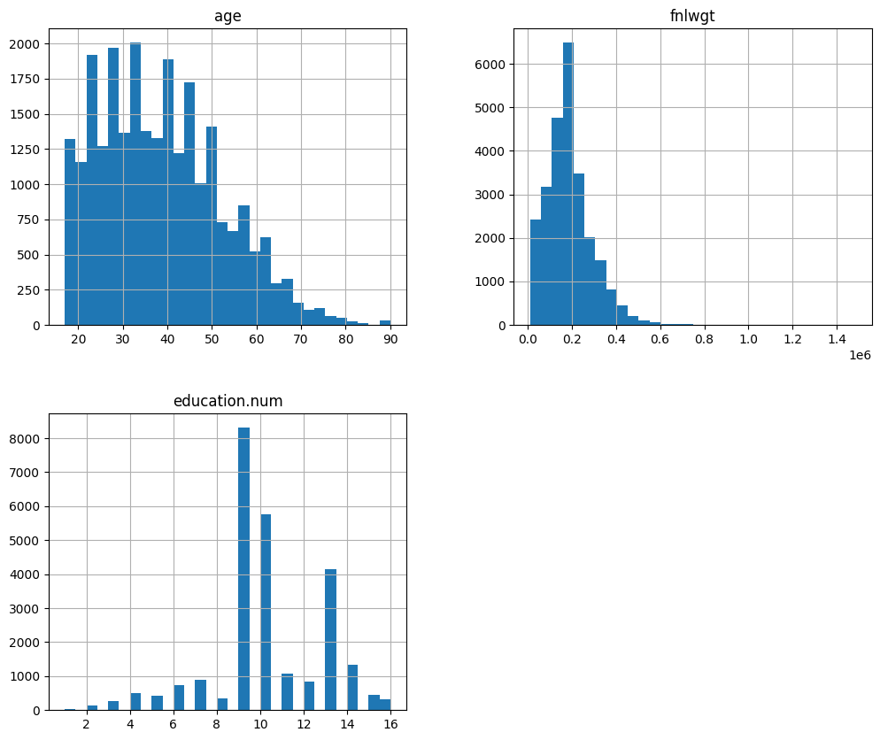
*Figura 1: Histogramas de frequência das variáveis numéricas no conjunto de treino.*

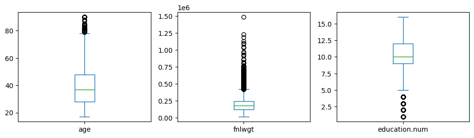
*Figura 2: Identificação de valores atípicos (outliers) via diagramas de caixa (Boxplots).*

**Principais constatações:**
- **`age`:** Apresenta assimetria positiva, com média de 38,5 anos e cauda estendendo-se até os 90 anos. Os valores acima de 75 anos aparecem como outliers estatísticos, mas representam idosos e aposentados reais.
- **`fnlwgt`:** Distribuição acentuadamente assimétrica com forte cauda à direita e dezenas de outliers extremos. Trata-se de um peso censitário amostral atribuído pelo governo americano e não de um atributo comportamental intrínseco.
- **`education.num`:** Concentração massiva nos valores 9 (conclusão do Ensino Médio - *HS-grad*), 10 (*Some-college*) e 13 (*Bachelors*). Valores inferiores a 5 anos de estudo surgem como cauda inferior.

### 3.2 Relação entre Idade, Escolaridade e Renda
A investigação cruzada entre idade, nível de estudo e faixa salarial comprova o impacto direto dessas variáveis na probabilidade de alta renda:

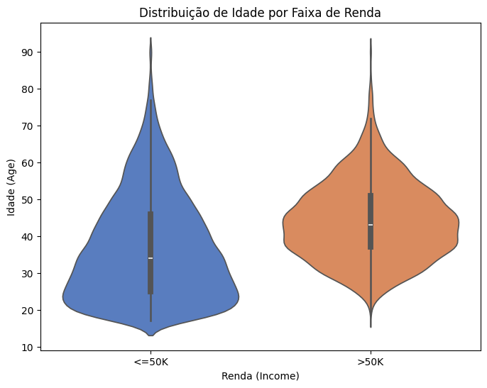
*Figura 3: Distribuição de densidade e quartis da idade condicionada à faixa de renda.*

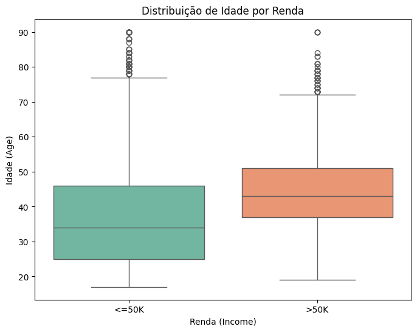
*Figura 4: Comparação direta das medianas e dispersão etária entre as classes de renda.*

A mediana de idade dos indivíduos que recebem mais de US\$ 50K gira em torno de **44 anos**, enquanto na classe de menor renda a mediana é de **34 anos**. A transição salarial ocorre tipicamente na fase de maturidade profissional e progressão na carreira.

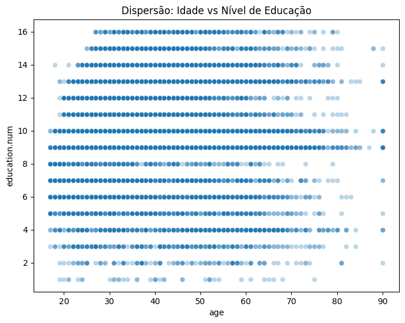
*Figura 5: Dispersão bidimensional de idade e anos de estudo formal com sobreposição por densidade.*

### 3.3 Variáveis Categóricas e Perfil Socioeconômico
Os gráficos de contagem segmentados pelo target destacam a influência do nível instrucional, do gênero e da ocupação:

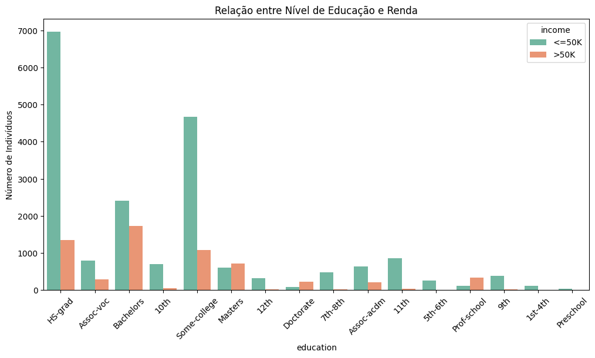
*Figura 6: Frequência absoluta de faixas de renda por nível educacional concluído.*

O limiar do ensino superior (*Bachelors*, *Masters*, *Doctorate*, *Prof-school*) inverte ou equipara a proporção da classe de alta renda. Em contrapartida, indivíduos com escolaridade até o ensino médio (*HS-grad* e anteriores) permanecem predominantemente na faixa `<=50K`.

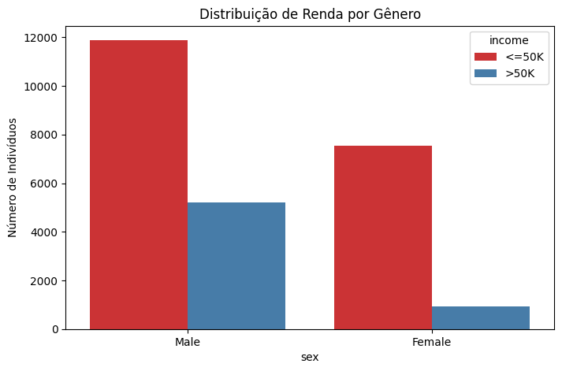
*Figura 7: Frequência de renda por sexo biológico.*

O dataset de 1994 reflete a acentuada desigualdade salarial de gênero da época nos Estados Unidos: entre os homens, cerca de 30% auferem renda superior a US\$ 50K; entre as mulheres, essa proporção cai para menos de 11%.

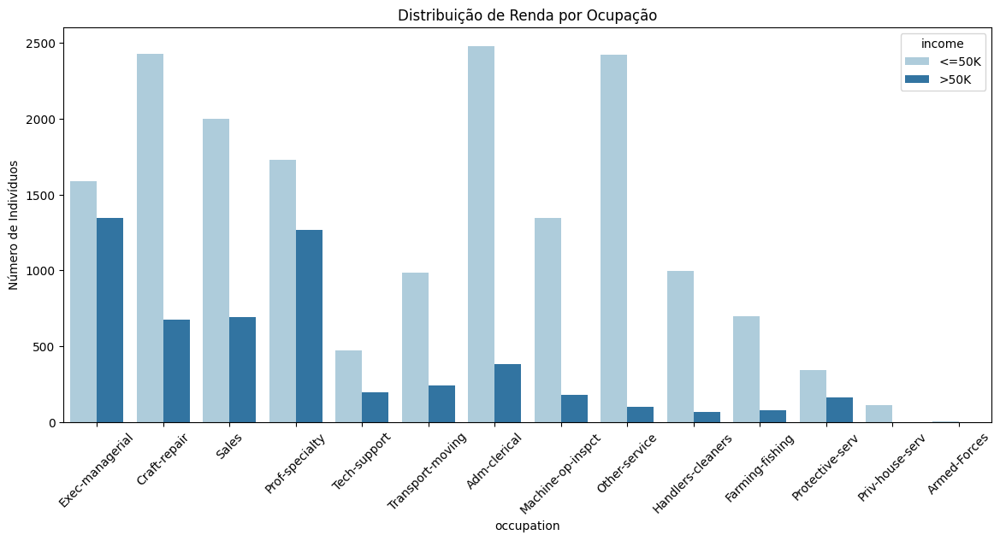
*Figura 8: Distribuição de renda por categoria ocupacional.*

Cargos gerenciais e profissionais especializados (*Exec-managerial*, *Prof-specialty*) concentram a maior proporção de indivíduos acima de US\$ 50K, superando ocupações operacionais ou de serviços (*Other-service*, *Handlers-cleaners*).

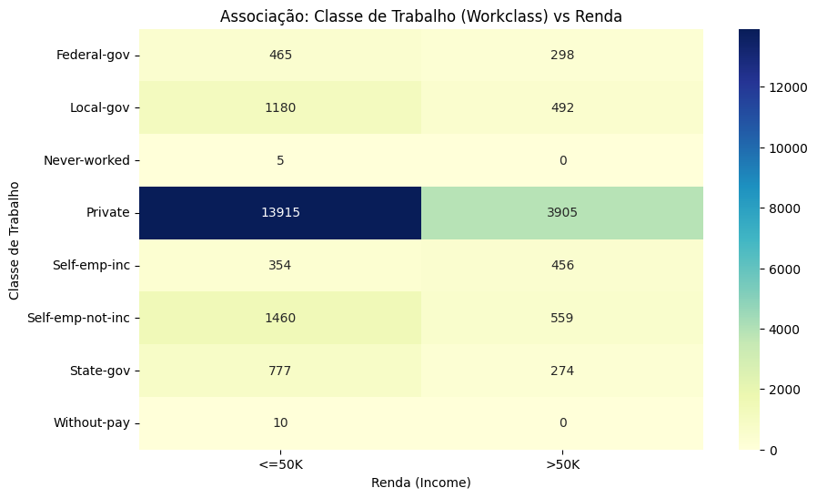
*Figura 9: Associação entre classe de trabalho (Workclass) e nível de renda.*

### 3.4 Correlação e Projeção Multivariada
A matriz de correlação das variáveis numéricas com a variável binária alvo (`income_num`) comprova as associações lineares:

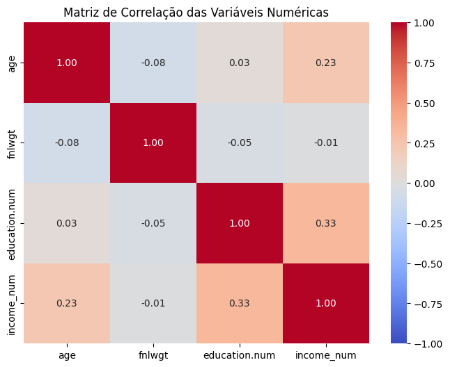
*Figura 10: Matriz de correlação de Pearson das variáveis numéricas com o target codificado.*

- `education.num` apresenta correlação positiva moderada com a renda ($r \approx +0.33$).
- `age` apresenta correlação positiva com a renda ($r \approx +0.23$).
- `fnlwgt` exibe correlação praticamente nula ($r \approx -0.01$) com a renda, confirmando a suspeita de que se trata de ruído amostral.

Na projeção por Análise de Componentes Principais (**PCA**) reduzida a duas dimensões:

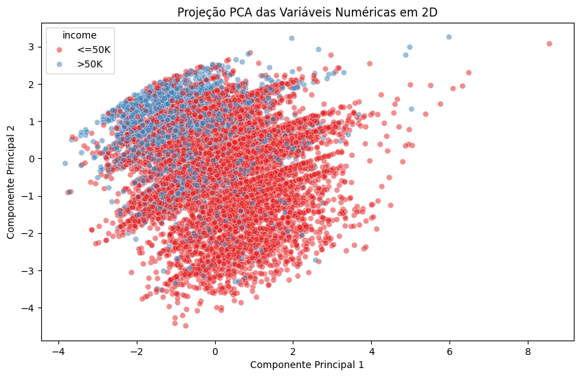
*Figura 11: Projeção bidimensional das variáveis numéricas padronizadas via PCA.*

As duas primeiras componentes explicam a dispersão numérica, mas apresentam sobreposição massiva das duas classes no espaço reduzido.

---

## 4. Engenharia de Dados & Pipeline Inicial (v1)

Com base nas evidências da análise exploratória, o grupo estruturou o pré-processador da APS 1 utilizando o `ColumnTransformer` do Scikit-Learn:

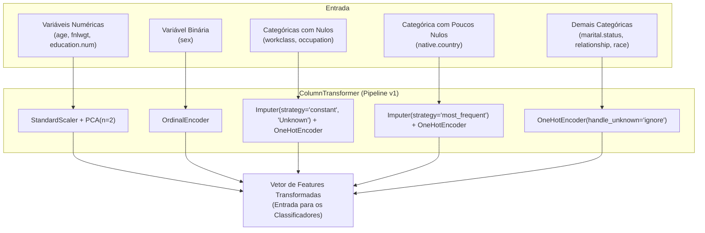

### Racional das Decisões Técnicas do Pipeline v1

1. **Tratamento de Dados Ausentes:**
    - Para `native.country` (apenas 23 nulos, 0,09%), aplicou-se a **moda** (`SimpleImputer(strategy='most_frequent')`), dado que mais de 90% dos registros pertencem à categoria majoritária (*United-States*). A alteração introduzida no sinal estatístico é desprezível.
    - Para `workclass` (1.407 nulos) e `occupation` (2.549 nulos), a imputação pela moda foi descartada, pois aumentaria artificialmente as classes mais frequentes em 8% e 82,20%, respectivamente, gerando grave distorção. Optou-se por criar uma categoria explícita `"Unknown"` (`strategy='constant', fill_value='Unknown'`), transformando a ausência do registro em informação preditiva utilizável.

2. **Tratamento de Outliers:**
    - Os valores extremos em `age` e `education.num` foram integralmente mantidos no dataset. Tratam-se de dados legítimos da população censitária (cidadãos idosos ou pós-graduados), e sua remoção arbitrária mutilaria a diversidade socioeconômica indispensável ao aprendizado.

3. **Codificação Categórica (*Encoding*):**
    - `OneHotEncoder` aplicado às variáveis nominais (`workclass`, `marital.status`, `race`, `native.country`, `occupation` e `relationship`), com `handle_unknown='ignore'` para mitigar erros em categorias inéditas.
    - `OrdinalEncoder` para a coluna binária `sex`.
    - A coluna descritiva `education` foi descartada, visto que `education.num` já fornece a ordem hierárquica perfeita em formato numérico.

4. **Escalonamento Numérico:**
    - Uso de `StandardScaler` (média 0 e variância unitária). A padronização z-score é superior ao *Min-Max Scaling* quando há outliers legítimos, pois não esmaga a densidade da distribuição principal num intervalo diminuto.

5. **Redução Dimensional (PCA):**
    - No Pipeline v1 original da APS 1, incluiu-se um redutor `PCA(n_components=2)` sobre as variáveis numéricas padronizadas para satisfazer os requisitos iniciais de redução de dimensão.

### Código Oficial do Pipeline v1 (APS 1)

```python
from sklearn.pipeline import Pipeline
from sklearn.compose import ColumnTransformer
from sklearn.impute import SimpleImputer
from sklearn.preprocessing import OneHotEncoder, StandardScaler, OrdinalEncoder
from sklearn.decomposition import PCA

# 1. Pipeline Numérico (Padronização + PCA)
pipe_num = Pipeline(steps=[
    ('scaler', StandardScaler()),
    ('pca', PCA(n_components=2))
])

# 2. Pipeline Categórico - Binário (Sexo)
pipe_cat_bin = Pipeline(steps=[
    ('ord', OrdinalEncoder(handle_unknown='use_encoded_value', unknown_value=-1))
])

# 3. Pipeline Categórico - Tratamento de Nulos com "Unknown"
pipe_cat_unk = Pipeline(steps=[
    ('imput_unk', SimpleImputer(strategy='constant', fill_value='Unknown')),
    ('ohe', OneHotEncoder(handle_unknown='ignore', sparse_output=False))
])

# 4. Pipeline Categórico - Tratamento de Nulos com a Moda
pipe_cat_moda = Pipeline(steps=[
    ('imput_moda', SimpleImputer(strategy='most_frequent')),
    ('ohe', OneHotEncoder(handle_unknown='ignore', sparse_output=False))
])

# 5. Pipeline Categórico - Demais Nominais
pipe_cat_ohe = Pipeline(steps=[
    ('ohe', OneHotEncoder(handle_unknown='ignore', sparse_output=False))
])

# 6. ColumnTransformer Unificado (Pipeline v1 da APS1)
preprocessor = ColumnTransformer(
    transformers=[
        ('num', pipe_num, ['age', 'fnlwgt', 'education.num']),
        ('bin', pipe_cat_bin, ['sex']),
        ('cat_unk', pipe_cat_unk, ['workclass', 'occupation']),
        ('cat_moda', pipe_cat_moda, ['native.country']),
        ('cat_nom', pipe_cat_ohe, ['marital.status', 'relationship', 'race'])
    ]
)
```

Este artefato pré-processador serviu como fundação para a seleção dos modelos na **APS 2 (Seção 1)**.
