# Predição de Renda Censitária — Adult Census Income

**Autores:** Léo Montefusco & Lucas Haro  
**Disciplina:** Machine Learning  
**Trabalho:** Atividade Prática Supervisionada (APS 1 & APS 2)  
**Dataset:** Adult Census Income (Censo Demográfico dos EUA, 1994)

---

## 📌 Resumo Executivo

Este projeto apresenta o ciclo completo de desenvolvimento, validação, interpretação e planejamento operacional de modelos de **Aprendizado de Máquina Supervisionado** para a tarefa de **Classificação Binária** sobre a base de dados *Adult Census Income*. 

O objetivo central é estimar com máxima fidelidade probabilística se a renda anual de um indivíduo ultrapassa o limiar de **US\$ 50.000 anuais** (`>50K` vs `<=50K`), a partir de 11 características demográficas e socioeconômicas (como idade, escolaridade, estado civil, ocupação e classe de trabalho).

```mermaid
flowchart LR
    A["Dados Brutos\n(31.947 instâncias)"] --> B["Split Estratificado\n(Treino 80% / Teste 20%)"]
    B --> C["APS 1: Pipeline v1\n(Scaler, PCA, OHE, Imputação)"]
    C --> D["Benchmarking\n(Dummy, LogReg, RandomForest)"]
    D --> E["Engenharia de Pipeline v2\n(Drop PCA & fnlwgt, Agrupamento Raro)"]
    E --> F["Hiperparametrização\n(GridSearch & RandomizedSearch)"]
    F --> G["Avaliação no Teste Blindado\n(ROC-AUC: 0.8910, Acc: 84.10%)"]
    G --> H["Interpretabilidade Global & Local\n(Coeficientes, MDI e SHAP)"]
    H --> I["MLOps & Operacionalização\n(FastAPI, Docker, Drift Monitoring)"]
```

---

## 🏆 Principais Resultados Obtidos

Em conformidade com as melhores práticas de Machine Learning e com as diretrizes do enunciado, o processo analítico foi dividido rigorosamente em duas fases: a **Fase de Seleção e Otimização (Validação Cruzada 5-Fold no Treino)** e a **Fase de Avaliação Final (Conjunto de Teste Blindado)**.

### Fase 1: Seleção, Otimização e Engenharia de Features (Treinamento)
Durante toda a Seção 1, o conjunto de teste (20%) permaneceu **estritamente lacrado** (*locked holdout*) para evitar vazamento de dados (*data snooping/leakage*). Todos os modelos foram avaliados via **Validação Cruzada Estratificada em 5 Dobras (`StratifiedKFold`)** utilizando a métrica **ROC-AUC**:

| Etapa | Modelo | Pipeline | Estratégia de Otimização | Hiperparâmetros Selecionados | ROC-AUC (CV 5-Fold) |
| :--- | :--- | :---: | :---: | :--- | :---: |
| **Baseline** | Dummy Classifier (*most frequent*) | v1 | Padrão | N/A | $0.500 \pm 0.000$ |
| **Linear Inicial** | Regressão Logística | v1 | Padrão ($L_2$) | `C=1.0, solver='lbfgs'` | $0.878 \pm 0.005$ |
| **Ensemble Inicial** | Random Forest | v1 | Padrão (100 árvores) | `n_estimators=100, depth=None` | $0.848 \pm 0.004$ |
| **Linear Otimizado** | Regressão Logística | v1 | `GridSearchCV` | `C=1.0, solver='lbfgs'` | **0.878** |
| **Ensemble Otimizado**| Random Forest | v1 | `RandomizedSearchCV` | `n_estimators=200, depth=20, leaf=4` | **0.879** |
| **Engenharia de Dados**| **Random Forest Campeã** | **v2 (Otimizado)** | **`RandomizedSearchCV`** | **`n_est=300, depth=20, leaf=4, feat='sqrt'`** | **0.8884** |

> [!TIP] Impacto da Engenharia de Dados (Pipeline v1 $\to$ Pipeline v2)
> A reformulação do pipeline na Seção 1 (remoção do PCA inadequado, exclusão do ruído amostral `fnlwgt` e agrupamento de categorias raras em `native.country`) gerou um salto expressivo de **0.8788 para 0.8884 (+0.0096)** no ROC-AUC em validação cruzada, consolidando a Random Forest como o modelo campeão absoluto para a etapa seguinte.

---

### Fase 2: Avaliação do Modelo Campeão no Conjunto de Teste Blindado
Conforme estipulado no item 2 do enunciado (*"Utilizando o melhor modelo obtido na seção 1, reportar as métricas junto ao conjunto de teste"*), o conjunto de teste inédito (6.390 instâncias) foi desbloqueado uma única vez para auditar a capacidade real de generalização da **Random Forest Campeã (Pipeline v2)**:

| Métrica no Teste | Valor Obtido | Descrição / Interpretação |
| :--- | :---: | :--- |
| **ROC-AUC (Teste)** | **0.8910** | Capacidade global de discriminação e ordenação probabilística (sem vazamento). |
| **Acurácia (Accuracy)** | **84.10%** | Proporção geral de predições corretas em todo o conjunto de teste. |
| **Precisão (Precision)** | **72.22%** | Taxa de acerto quando o modelo prediz a classe de alta renda (`>50K`). |
| **Revocação (Recall)** | **56.67%** | Capacidade de identificar os indivíduos que efetivamente ganham `>50K`. |
| **F1-Score** | **63.51%** | Média harmônica balanceando precisão e revocação na classe minoritária. |

> [!NOTE] Rigor Metodológico: Por que os Modelos Preliminares não Possuem Métricas de Teste?
> Em Ciência de Dados, **o conjunto de teste nunca deve ser utilizado para comparar modelos intermediários ou guiar decisões de engenharia de features**. Avaliar modelos preliminares no teste provocaria contaminação (*test leakage* ou *data snooping*), invalidando a estimativa imparcial de erro de generalização. Por essa razão, em estrito cumprimento ao enunciado do professor, o teste foi preservado exclusivamente para o modelo campeão final.

---

## 🧭 Estrutura da Documentação e Alinhamento com o Enunciado

Esta documentação foi rigorosamente estruturada para cobrir todos os requisitos acadêmicos da APS 1 e da APS 2, oferecendo profundidade teórica, reprodutibilidade de código e embasamento crítico:

1. **[APS 1 — Fundamentos, Análise Exploratória e Pipeline v1](aps1.md)**
    - Dicionário de variáveis e diagnóstico estrutural da base (31.947 linhas e 12 colunas).
    - Análise de valores ausentes (`?` e `occupation`) e estratégia de imputação fundamentada.
    - Análise bivariada e multivariada com gráficos de dispersão, histogramas, boxplots e heatmaps.
    - Construção do primeiro `ColumnTransformer` (Pipeline v1) com padronização e PCA.

2. **[Seção 1 — Seleção, Implementação e Otimização dos Modelos](secao1.md)**
    - Implementação dos 3 modelos obrigatórios: Dummy, Linear Regularizado (Regressão Logística L2) e Ensemble de Árvores (Random Forest).
    - Escolha e justificativa formal da métrica de avaliação: **ROC-AUC** frente ao desbalanceamento de classes (76% vs 24%).
    - Otimização via `GridSearchCV` (Linear) e `RandomizedSearchCV` (Ensemble) em validação cruzada 5-fold estratificada (`StratifiedKFold`).
    - Diagnóstico das deficiências do Pipeline v1 e formulação de **3 mudanças estruturais** (Pipeline v2).
    - Avaliação do impacto da mudança no melhor modelo e construção das **Curvas de Aprendizado (Learning Curves)** com análise do trade-off viés-variância.

3. **[Seção 2 — Avaliação do Melhor Modelo no Conjunto de Teste](secao2.md)**
    - Protocolo de blindagem do conjunto de teste (20% das instâncias, 6.390 registros).
    - Relatório completo de métricas de classificação: Acurácia (84.10%), Precisão (72.22%), Recall (56.67%) e F1-Score (63.51%).
    - Apresentação e decomposição exaustiva da **Matriz de Confusão** (Verdadeiros Negativos, Falsos Positivos, Falsos Negativos e Verdadeiros Positivos).
    - Traçado da **Curva ROC** e cálculo do **ROC-AUC no teste (0.8910)**, comprovando generalização sem vazamento (*data leakage*).
    - Nota metodológica esclarecendo a natureza estrita de classificação binária do problema e sua distinção frente a tarefas de regressão.

4. **[Seção 3 — Interpretação e Explicabilidade dos Modelos](secao3.md)**
    - Análise dos **3 coeficientes de maior magnitude** do modelo linear (`workclass_Unknown`, `relationship_Own-child`, `marital.status_Married-AF-spouse`) sob a ótica de *odds ratios*.
    - Análise das **3 variáveis de maior importância** da Random Forest via impureza de Gini (*MDI*): `education.num`, `marital.status_Married-civ-spouse` e `age`.
    - Explicabilidade global via **SHAP (SHapley Additive exPlanations)** com *TreeExplainer*.
    - Decomposição local de **3 predições individuais** via *Waterfall Plots*, detalhando quantitativamente como cada feature afastou a probabilidade do valor base $E[f(X)] = 0.24$.

5. **[Seção 4 — Discussão Crítica, Limitações e MLOps](secao4.md)**
    - Discussão técnica aprofundada de **duas limitações do melhor modelo** (latência/custo de inferência em produção e viés de impureza de Gini com correlação de atributos).
    - Discussão de **duas limitações intrínsecas dos dados** (defasagem temporal de 3 décadas com *concept drift*/inflação e perda drástica de informação pela binarização da renda contínua).
    - Proposta de **duas ações concretas de operacionalização e manutenção**: Microsserviço conteinerizado via FastAPI + Docker e Monitoramento Contínuo de *Data Drift* / *Concept Drift* com pipeline automatizado de retreino.

6. **[Referências Bibliográficas & Apêndice Técnico](referencias.md)**
    - Referências bibliográficas completas no padrão ABNT (Hastie, Strobl, Gama, Sculley et al.).
    - Tabela de rastreabilidade de código e hiperparâmetros.
