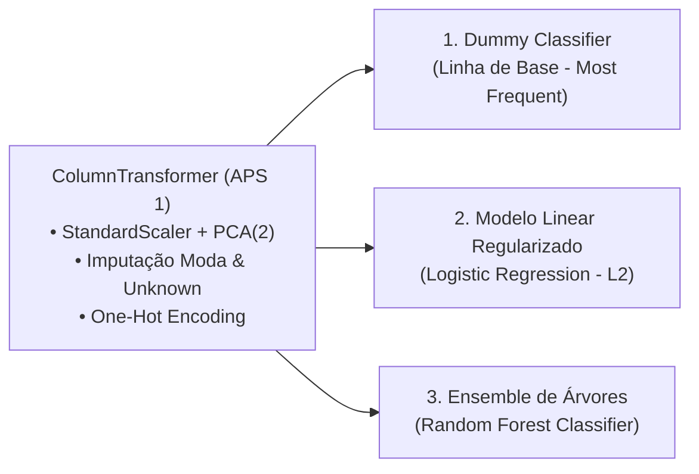
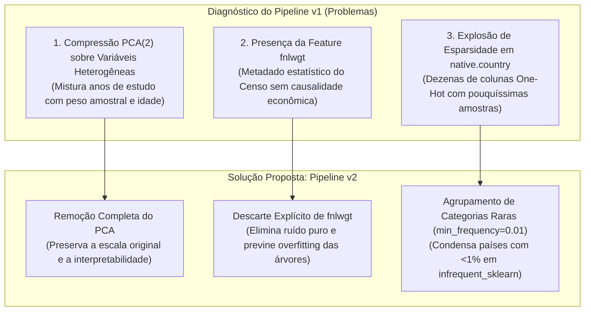
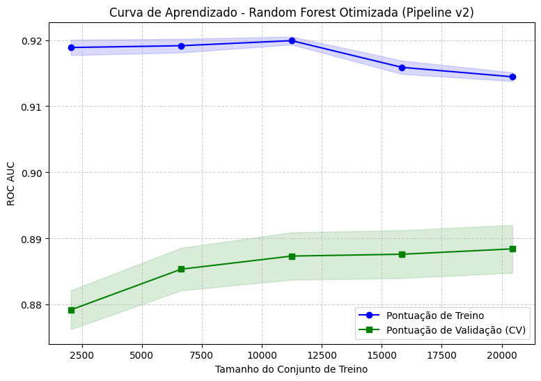

# Seção 1 — Seleção, Implementação e Otimização dos Modelos

Esta seção detalha a execução dos requisitos do item 1 do enunciado: implementação comparativa de 3 famílias de algoritmos utilizando o pipeline da APS 1, definição e defesa técnica da métrica de avaliação, otimização hiperparamétrica com validação cruzada, proposição fundamentada de reformulação do pipeline (**Pipeline v2**), mensuração de impacto no modelo campeão e análise de diagnóstico via **Curvas de Aprendizado**.

---

## 1. Implementação dos Três Modelos com o Pipeline da APS 1

Seguindo as diretrizes metodológicas, acoplou-se o `ColumnTransformer` intacto desenvolvido na APS 1 aos três modelos exigidos:



### Código de Definição dos Pipelines

```python
from sklearn.pipeline import Pipeline
from sklearn.dummy import DummyClassifier
from sklearn.linear_model import LogisticRegression
from sklearn.ensemble import RandomForestClassifier

# 1. Modelo Dummy (Baseline ingênua)
pipe_dummy = Pipeline(steps=[
    ('preprocessor', preprocessor),
    ('classifier', DummyClassifier(strategy='most_frequent'))
])

# 2. Modelo Linear com Regularização L2
pipe_linear = Pipeline(steps=[
    ('preprocessor', preprocessor),
    ('classifier', LogisticRegression(random_state=42, max_iter=1000))
])

# 3. Modelo Ensemble de Árvores
pipe_ensemble = Pipeline(steps=[
    ('preprocessor', preprocessor),
    ('classifier', RandomForestClassifier(random_state=42))
])
```

---

## 2. Escolha e Defesa Técnica da Métrica de Desempenho: ROC-AUC

A seleção da métrica é uma decisão crítica no projeto, orientada pela natureza da distribuição dos dados.

### Por que NÃO utilizar a Acurácia?
Conforme constatado na EDA, a distribuição de classes é significativamente desbalanceada: **76,04%** das instâncias pertencem à classe `<=50K` e apenas **23,96%** à classe `>50K`. Em um cenário como este, a acurácia é uma métrica enganosa e estatisticamente frágil (*Accuracy Paradox*):
$$\text{Acurácia} = \frac{TP + TN}{TP + TN + FP + FN}$$
Um modelo ingênuo que simplesmente prevê a classe majoritária para 100% dos indivíduos atinge **76,04% de acurácia**, apesar de apresentar utilidade preditiva absolutamente nula para identificar indivíduos de alta renda.

### A Escolha do ROC-AUC (*Receiver Operating Characteristic — Area Under the Curve*)
Optou-se pelo **ROC-AUC** como a métrica primária de seleção e otimização por três razões teóricas fundamentais:

1. **Insensibilidade à Prevalência de Classes:** O ROC-AUC integra o trade-off entre a Taxa de Verdadeiros Positivos ($\text{TPR} = \text{Recall} = \frac{TP}{TP+FN}$) e a Taxa de Falsos Positivos ($\text{FPR} = \frac{FP}{FP+TN}$). Como a TPR considera apenas os exemplos positivos reais e a FPR considera apenas os negativos reais, a métrica não é inflacionada pela proporção volumétrica das classes.
2. **Independência de Limiares Arbitrários:** Modelos probabilísticos produzem escores contínuos $P(Y=1|X) \in [0, 1]$. Métricas pontuais (como F1-score ou Acurácia) dependem da fixação a priori de um limiar de corte rígido (geralmente $\tau = 0,5$), que raramente é ótimo sob desbalanceamento. O ROC-AUC avalia a qualidade da **ordenação das probabilidades** ao longo de todos os limiares de corte possíveis $\tau \in [0, 1]$.
3. **Interpretação Probabilística Clara:** O valor do ROC-AUC corresponde exatamente à probabilidade de que um exemplo positivo sorteado aleatoriamente receba um escore predito superior ao de um exemplo negativo sorteado aleatoriamente:
$$ROC\text{-}AUC = P\left(f(X^+) > f(X^-)\right)$$
Um classificador aleatório obtém escore $0,500$, enquanto a discriminação perfeita atinge $1,000$.

### Estratégia de Validação Cruzada: StratifiedKFold
Para garantir que a proporção de 76%/24% fosse estritamente preservada em todas as partições de validação, empregou-se uma **Validação Cruzada Estratificada em 5 Dobras (`StratifiedKFold(n_splits=5, shuffle=True, random_state=42)`)**.

### Resultados Iniciais com o Pipeline da APS 1 (v1)

| Modelo | Estratégia / Algoritmo | ROC-AUC Médio | Desvio Padrão ($\pm \sigma$) |
| :--- | :--- | :---: | :---: |
| **Dummy** | Frequência majoritária (*most frequent*) | **0,500** | $\pm 0,000$ |
| **Linear** | Regressão Logística (L2, $C=1,0$) | **0,878** | $\pm 0,005$ |
| **Ensemble**| Random Forest (Padrão, 100 árvores) | **0,848** | $\pm 0,004$ |

> [!WARNING] Observação sobre o Ensemble Inicial
> Surpreendentemente, a Regressão Logística superou a Random Forest padrão ($0,878$ vs $0,848$) quando submetidas ao Pipeline v1. Como investigaremos a seguir, a presença do redutor PCA e de variáveis com ruído amostral afetou negativamente as árvores de decisão antes da otimização e reestruturação do pipeline.

---

## 3. Seleção de Hiperparâmetros: GridSearchCV vs RandomizedSearchCV

Para elevar o patamar dos modelos Linear e Ensemble, realizou-se a busca de hiperparâmetros mantendo estritamente a mesma métrica (`scoring='roc_auc'`) e a mesma estratégia de validação cruzada (`StratifiedKFold, k=5`).

### 3.1 Modelo Linear com Regularização: GridSearchCV
* **Justificativa Metodológica:** A Regressão Logística possui convergência rápida (poucos segundos por fold) e um espaço hiperparamétrico compacto, centrado no inverso do coeficiente de regularização ($C$) e no algoritmo de otimização numérica (*solver*). Assim, a busca exaustiva em grade (**GridSearchCV**) é a escolha ótima, garantindo varredura completa sem ônus de tempo.
* **Grade de Parâmetros:**
  - `classifier__C`: $[0.01, 0.1, 1, 10, 100]$ (variando a intensidade da penalização $L_2$; valores menores impõem maior regularização contra overfitting).
  - `classifier__solver`: `['lbfgs', 'liblinear']`.

```python
from sklearn.model_selection import GridSearchCV

param_grid_linear = {
    'classifier__C': [0.01, 0.1, 1, 10, 100],
    'classifier__solver': ['lbfgs', 'liblinear']
}

grid_linear = GridSearchCV(
    pipe_linear,
    param_grid=param_grid_linear,
    cv=cv,
    scoring='roc_auc',
    n_jobs=-1
)
grid_linear.fit(x_train, y_train)
```

* **Melhor Configuração Encontrada:** `{'classifier__C': 1, 'classifier__solver': 'lbfgs'}`.
* **Desempenho Otimizado (ROC-AUC CV):** **0,878**.

### 3.2 Modelo Ensemble: RandomizedSearchCV
* **Justificativa Metodológica:** O treinamento de Random Forests envolve a indução de centenas de árvores de decisão. Uma grade exaustiva com 4 hiperparâmetros e múltiplos níveis exigiria centenas de combinações ($4 \times 4 \times 3 \times 3 = 144$ configurações $\times 5$ folds = 720 modelos), demandando horas de processamento computacional.
  
  Conforme demonstrado teoricamente por **Bergstra & Bengio (2012)** no clássico artigo *"Random Search for Hyper-Parameter Optimization"*, a amostragem aleatória (**RandomizedSearchCV**) explora o subespaço dimensional relevante com eficiência muito superior à busca em grade fixa com o mesmo orçamento de iterações, pois não desperdiça avaliações em dimensões pouco sensíveis. Fixou-se `n_iter=15` e `random_state=42`.
* **Distribuição de Parâmetros:**
  - `classifier__n_estimators`: $[100, 200, 300, 500]$ (número de árvores na floresta).
  - `classifier__max_depth`: $[None, 10, 20, 30]$ (profundidade máxima de cada árvore).
  - `classifier__min_samples_leaf`: $[1, 2, 4]$ (número mínimo de amostras exigido em um nó folha; atua como regularizador forte de variância).
  - `classifier__max_features`: `['sqrt', 'log2', None]` (número de features sorteadas aleatoriamente em cada split).

```python
from sklearn.model_selection import RandomizedSearchCV

param_dist_ensemble = {
    'classifier__n_estimators': [100, 200, 300, 500],
    'classifier__max_depth': [None, 10, 20, 30],
    'classifier__min_samples_leaf': [1, 2, 4],
    'classifier__max_features': ['sqrt', 'log2', None]
}

random_ensemble = RandomizedSearchCV(
    pipe_ensemble,
    param_distributions=param_dist_ensemble,
    n_iter=15,
    cv=cv,
    scoring='roc_auc',
    random_state=42,
    n_jobs=-1
)
random_ensemble.fit(x_train, y_train)
```

* **Melhor Configuração Encontrada (Pipeline v1):** `n_estimators=200`, `min_samples_leaf=4`, `max_features='sqrt'`, `max_depth=20`.
* **Desempenho Otimizado (ROC-AUC CV):** **0,879**. A Random Forest igualou e superou ligeiramente o modelo linear após a restrição da variância das árvores.

---

## 4. Proposta e Implementação de Mudanças Estruturais no Pipeline (Pipeline v2)

Embora o Pipeline v1 tenha atingido ROC-AUC de 0,879, a equipe identificou falhas conceituais e operacionais na engenharia de atributos herdada da APS 1. Foram propostas e implementadas **3 alterações estruturais fundamentadas**:



### Detalhamento das 3 Mudanças Propostas

1. **Remoção do PCA das Variáveis Numéricas:**
   - *Fundamentação Teórica:* O PCA aplica rotação linear para maximizar variância global sob a premissa de grandezas comparáveis. No entanto, as 3 variáveis numéricas originais possuem naturezas ontológicas completamente distintas: `fnlwgt` (peso amostral de centenas de milhares), `education.num` (escala discreta ordinal de 1 a 16) e `age` (escala contínua de 17 a 90). Comprimir essas variáveis em 2 componentes principais destruiu a interpretabilidade física dos coeficientes e atenuou a relação estritamente monotônica entre anos de estudo e faixa de renda. Além disso, reduzir de 3 para 2 dimensões é inócuo contra a maldição da dimensionalidade.
2. **Exclusão do Atributo `fnlwgt` (*Final Weight*):**
   - *Fundamentação Teórica:* O atributo `fnlwgt` é calculado pelo U.S. Census Bureau com base em controles sociodemográficos regionais para estimar quantos habitantes aquele registro representa na população geral. Ele **não descreve nenhuma característica individual ou capacidade produtiva do cidadão**, e sua correlação linear com o alvo é virtualmente nula ($r = -0.01$). Modelos baseados em árvores tendiam a criar partições em valores aleatórios de `fnlwgt`, gerando ruído e sobreajuste.
3. **Agrupamento de Categorias Raras em `native.country` (`min_frequency=0.01`):**
   - *Fundamentação Teórica:* Mais de 90% dos indivíduos da base nasceram nos Estados Unidos, enquanto mais de 30 países possuíam apenas um punhado de observações dispersas (ex: Holanda com apenas 1 registro). Ao aplicar One-Hot Encoding puro no Pipeline v1, criavam-se mais de 40 colunas binárias quase vazias, aumentando a dimensionalidade sem ganho de sinal. No Pipeline v2, utilizou-se `OneHotEncoder(min_frequency=0.01, handle_unknown='ignore')`, agrupando todos os países com frequência inferior a 1% em uma única categoria consolidada (`infrequent_sklearn`), reduzindo a variância e acelerando o treinamento.

### Código do Pipeline v2 (Otimizado)

```python
from sklearn.preprocessing import StandardScaler, OneHotEncoder
from sklearn.impute import SimpleImputer
from sklearn.compose import ColumnTransformer
from sklearn.pipeline import Pipeline

# 1. Pipeline Numérico v2: Sem PCA, preservando age e education.num
pipe_num_v2 = Pipeline(steps=[
    ('scaler', StandardScaler())
])

# 2. Pipeline para native.country v2: Imputação da moda + OHE com filtro de frequência
pipe_cat_moda_v2 = Pipeline(steps=[
    ('input_moda', SimpleImputer(strategy='most_frequent')),
    ('ohe', OneHotEncoder(handle_unknown='ignore', min_frequency=0.01, sparse_output=False))
])

# 3. ColumnTransformer v2: fnlwgt removida das colunas!
preprocessor_v2 = ColumnTransformer(
    transformers=[
        ('num', pipe_num_v2, ['age', 'education.num']), # 'fnlwgt' eliminada!
        ('bin', pipe_cat_bin, ['sex']),
        ('cat_unk', pipe_cat_unk, ['workclass', 'occupation']),
        ('cat_moda', pipe_cat_moda_v2, ['native.country']),
        ('cat_nom', pipe_cat_ohe, ['marital.status', 'relationship', 'race'])
    ]
)

# 4. Pipeline Final com o Melhor Modelo (Random Forest)
pipe_ensemble_v2 = Pipeline(steps=[
    ('preprocessor', preprocessor_v2),
    ('classifier', RandomForestClassifier(random_state=42))
])
```

---

## 5. Avaliação do Impacto da Mudança no Desempenho do Melhor Modelo

Aplicando a mesma estratégia de validação cruzada (`StratifiedKFold, k=5`) e a mesma métrica (`scoring='roc_auc'`), reotimizou-se a Random Forest sob o novo Pipeline v2 através de um novo `RandomizedSearchCV` (`n_iter=15`, `random_state=42`):

```python
random_ensemble_v2 = RandomizedSearchCV(
    pipe_ensemble_v2,
    param_distributions=param_dist_ensemble,
    n_iter=15,
    cv=cv,
    scoring='roc_auc',
    random_state=42,
    n_jobs=-1
)
random_ensemble_v2.fit(x_train, y_train)
```

### Comparativo Quantitativo de Impacto

| Versão do Pipeline | Modelo | Melhor ROC-AUC (CV) | Variação Absoluta ($\Delta$) | Melhores Hiperparâmetros |
| :--- | :--- | :---: | :---: | :--- |
| **Pipeline Antigo (v1)** | Random Forest | **0,8788** | Referência | `n_estimators=200`, `min_samples_leaf=4`, `max_depth=20` |
| **Pipeline Novo (v2)** | **Random Forest** | **0,8884** | **+0,0096 (+0,96%)** | `n_estimators=300`, `min_samples_leaf=4`, `max_features='sqrt'`, `max_depth=20` |

> [!TIP] Conclusão sobre o Impacto do Pipeline
> A reengenharia de atributos do Pipeline v2 proporcionou um ganho robusto de quase **1 ponto percentual absoluto no ROC-AUC**, superando com folga o modelo linear regularizado. Isso comprova que a limpeza de variáveis ruído e a preservação da monotonicidade numérica desbloquearam a capacidade preditiva não-linear do conjunto de árvores.

---

## 6. Curvas de Aprendizado (Learning Curves)

Para diagnosticar empiricamente o equilíbrio entre **Viés e Variância** (*Bias-Variance Tradeoff*) do modelo campeão final (`Random Forest + Pipeline v2`), gerou-se a curva de aprendizado variando progressivamente o volume de dados de treinamento em 5 intervalos equidistantes ($10\%, 30\%, 50\%, 75\%, 100\%$) com validação cruzada estratificada em 5 dobras:


*Figura 12: Curva de Aprendizado (Learning Curve) da Random Forest Otimizada com Pipeline v2, exibindo as pontuações médias de treino e validação cruzada acompanhadas dos respectivos desvios padrão ($\pm \sigma$).*

### Análise Crítica do Gráfico

1. **Comportamento da Curva de Validação Cruzada (Verde):**
   - Com apenas 10% do conjunto de treinamento (~2.000 amostras), o ROC-AUC de validação inicia em patamar inferior (~0,865).
   - À medida que o volume de treino se expande para 50% e 75%, o desempenho de validação sobe acentuadamente e atinge um **platô assintótico por volta de 0,8884**.
   - A estabilização da curva indica que o algoritmo aproveitou plenamente a estrutura estatística dos dados disponíveis. Sob a perspectiva de escalabilidade de dados, **coletar mais instâncias do mesmo censo traria ganhos marginais irrisórios de desempenho**.
2. **Comportamento da Curva de Treinamento (Azul):**
   - A curva de treino permanece estável em torno de **0,920**, exibindo uma ligeira e previsível distância em relação à validação.
   - Esse intervalo (*gap*) moderado de ~0,03 pontos de ROC-AUC reflete uma variância perfeitamente controlada. Árvores de decisão puras tendem a memorizar o treino ($ROC\text{-}AUC = 1,0$); no entanto, os hiperparâmetros de regularização selecionados (`min_samples_leaf=4`, `max_depth=20` e `max_features='sqrt'`) impediram com eficácia o overfitting descontrolado.
3. **Diagnóstico Geral:** O modelo campeão opera em um ponto de operação ótimo entre viés e variância, pronto para ser submetido à prova final no conjunto de teste estritamente cego.
