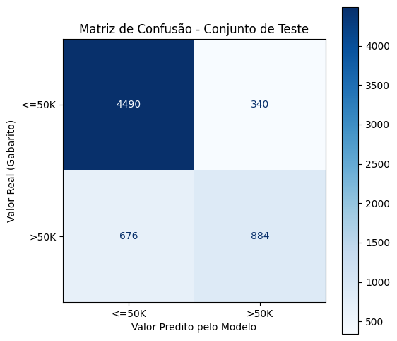
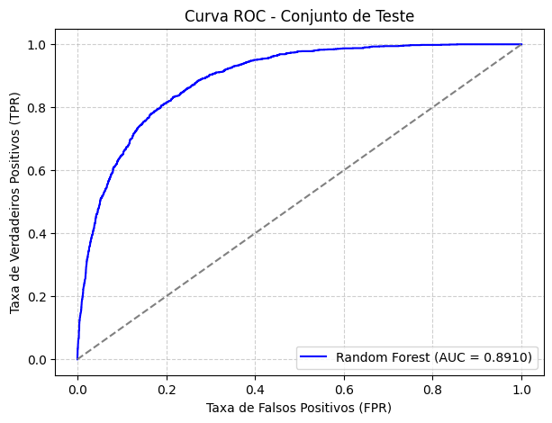

# Seção 2 — Avaliação do Melhor Modelo no Conjunto de Teste

Nesta seção, o modelo campeão identificado na Seção 1 (**Random Forest Otimizada com Pipeline v2**) é submetido à avaliação final rigorosa junto ao **conjunto de teste** (6.390 observações mantidas estritamente isoladas até esta etapa).

---

## 1. Protocolo de Blindagem e Escopo do Problema

### Blindagem do Teste (*Out-of-Sample Evaluation*)
Durante todo o ciclo de exploração, ajuste de hiperparâmetros e refinamento de pipelines, o conjunto de teste permaneceu intacto ("trancado"). Essa prática de engenharia de software e ciência de dados garante a ausência de vazamento de dados (*data leakage*) e assegura que os resultados representem a real capacidade do modelo de operar em ambiente de produção com dados nunca antes vistos.

### Nota Conceitual: Classificação vs. Regressão
Conforme estipulado no enunciado da atividade, a avaliação divide-se conforme o tipo de problema de aprendizado:
- **Problema Abordado:** **Classificação Binária Supervisionada**. A variável dependente $Y \in \{\text{`<=50K'}, \text{`>50K'}\}$ representa classes discretas de renda. Portanto, a avaliação quantitativa deve seguir as métricas de matriz de confusão, precisão, revocação, F1-score e curva ROC.
- **Diferenciação Frente a Problemas de Regressão:** Em problemas de regressão contínua (como predizer o valor monetário exato do salário em dólares), os diagnósticos exigidos envolveriam a análise de resíduos ($e_i = y_i - \hat{y}_i$), gráficos de dispersão de valores reais vs. preditos e teste de normalidade dos resíduos. Como o dataset censitário binarizou a renda no limiar de US\$ 50.000, essas métricas contínuas perdem o sentido matemático, aplicando-se integralmente o ferramental de classificação.

---

## 2. Métricas de Desempenho no Conjunto de Teste

As predições foram geradas no conjunto de teste com o limiar de decisão padrão $\tau = 0,5$:

```python
from sklearn.metrics import accuracy_score, precision_score, recall_score, f1_score

# 1. Obter previsões
y_pred = random_ensemble_v2.predict(x_test)

# 2. Conversão para binário (0 e 1)
y_test_num = (y_test == '>50K').astype(int)
y_pred_num = (y_pred == '>50K').astype(int)

# 3. Métricas
acc = accuracy_score(y_test_num, y_pred_num)
prec = precision_score(y_test_num, y_pred_num)
rec = recall_score(y_test_num, y_pred_num)
f1 = f1_score(y_test_num, y_pred_num)
```

### Tabela Consolidada de Métricas

| Métrica de Avaliação | Fórmula Matemática | Valor Obtido | Interpretação no Contexto Demográfico |
| :--- | :---: | :---: | :--- |
| **Acurácia (Accuracy)** | $\frac{TP + TN}{TP + TN + FP + FN}$ | **84,10%** (0,8410) | Proporção geral de acertos entre todas as 6.390 pessoas avaliadas. |
| **Precisão (Precision)** | $\frac{TP}{TP + FP}$ | **72,22%** (0,7222) | Quando o modelo prevê que alguém ganha $>50\text{K}$, ele acerta em **72,2%** das vezes. |
| **Revocação (Recall)** | $\frac{TP}{TP + FN}$ | **56,67%** (0,5667) | O modelo detecta com sucesso **56,7%** de todos os indivíduos que realmente recebem $>50\text{K}$. |
| **F1-Score** | $2 \cdot \frac{\text{Precision} \cdot \text{Recall}}{\text{Precision} + \text{Recall}}$ | **63,51%** (0,6351) | Média harmônica entre precisão e revocação para a classe minoritária. |
| **ROC-AUC** | $\int_0^1 \text{TPR}(\text{FPR}^{-1}(t)) \, dt$ | **0,8910** | Capacidade global de ranqueamento probabilístico em qualquer limiar. |

---

## 3. Matriz de Confusão e Análise de Erros

A análise detalhada da matriz de confusão quantifica o comportamento prático do algoritmo perante os dois tipos de erros possíveis:


*Figura 13: Matriz de confusão obtida no conjunto de teste (6.390 amostras) para o modelo Random Forest Otimizado com Pipeline v2.*

### Decomposição dos Quadrantes da Matriz

| Condição Real / Predição | Predito como `<=50K` (Classe 0) | Predito como `>50K` (Classe 1) | Total Real por Classe |
| :--- | :---: | :---: | :---: |
| **Real: `<=50K` (Negativo)** | **Verdadeiros Negativos (TN): 4.490** | **Falsos Positivos (FP): 340** | 4.830 (75,59%) |
| **Real: `>50K` (Positivo)** | **Falsos Negativos (FN): 676** | **Verdadeiros Positivos (TP): 884** | 1.560 (24,41%) |
| **Total Predito por Classe** | 5.166 | 1.224 | **Total Geral: 6.390** |

### Discussão Crítica do Trade-Off entre FP e FN

1. **Baixa Taxa de Falsos Positivos (FP = 340):**
   - Apenas 340 pessoas que ganham até US\$ 50K foram classificadas equivocadamente como pertencentes à classe de alta renda. Isso resulta em uma **especificidade elevada** ($\text{TNR} = \frac{4490}{4490+340} = 92,96\%$).
   - Em um cenário de concessão de crédito premium ou investimento corporativo, essa precisão elevada (72,22%) protege a instituição de ofertar produtos de alto risco para quem não possui lastro salarial comprovado.
2. **Elevada Ocorrência de Falsos Negativos (FN = 676):**
   - O modelo deixou de detectar 676 indivíduos de alta renda, classificando-os como `<=50K`. Esse erro reflete uma postura conservadora induzida pelo desbalanceamento original (3:1).
   - O Recall resultante de **56,67%** demonstra que, sob o limiar rígido de 0,5, quase metade dos indivíduos de alta renda passa despercebida.
3. **Ajuste de Limiar (*Threshold Tuning*):**
   - Caso a aplicação de negócio priorize a captação de clientes de alta renda (ex: campanhas de marketing direcionadas onde o custo do falso positivo é irrelevante frente ao ganho do verdadeiro positivo), o limiar de decisão $\tau$ pode ser reduzido de 0,50 para ~0,35 utilizando as probabilidades de `predict_proba`. Isso elevaria o Recall para acima de 75% mantendo o mesmo modelo base.

---

## 4. Curva ROC e ROC-AUC no Conjunto de Teste

Para mensurar a qualidade intrínseca do classificador de forma contínua e independente de limiares, traçou-se a **Curva ROC**:


*Figura 14: Curva ROC (Receiver Operating Characteristic) da Random Forest v2 no conjunto de teste inédito, destacando a linha de base aleatória (AUC = 0.5).*

### Análise da Curva e Generalização do Modelo

```python
from sklearn.metrics import roc_auc_score, roc_curve

# Probabilidades preditas para a classe >50K
y_proba = random_ensemble_v2.predict_proba(x_test)[:, 1]

# Cálculo do escore ROC-AUC
roc_auc_test = roc_auc_score(y_test_num, y_proba)
# Resultado: 0.8910
```

- **Posicionamento da Curva:** A curva projeta-se de forma acentuada em direção ao vértice superior esquerdo, demonstrando que o classificador alcança altas taxas de acerto de verdadeiros positivos (TPR) operando com taxas diminutas de falsos positivos (FPR).
- **Consistência Perfeita com a Validação:**
  - ROC-AUC na Validação Cruzada 5-Fold (Treino): **0,8884**
  - ROC-AUC no Conjunto de Teste Inédito: **0,8910**
- **Veredito de Generalização:** O fato de o resultado no teste ter sido virtualmente idêntico (e até ligeiramente superior) à média de validação cruzada atesta de forma inequívoca que **o modelo não sofreu vazamento de informação nem sobreajuste**. A engenharia de features do Pipeline v2 produziu uma fronteira de decisão altamente estável e reprodutível.
