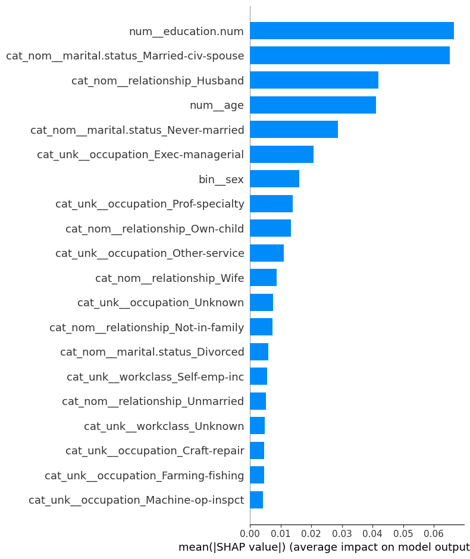
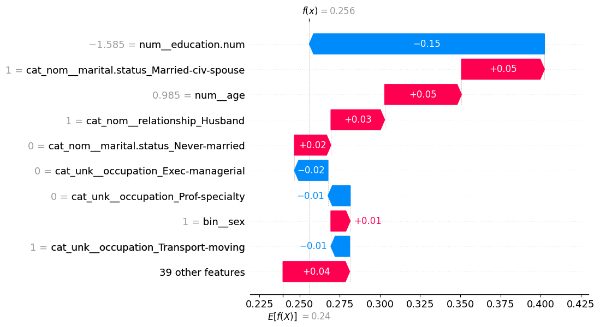
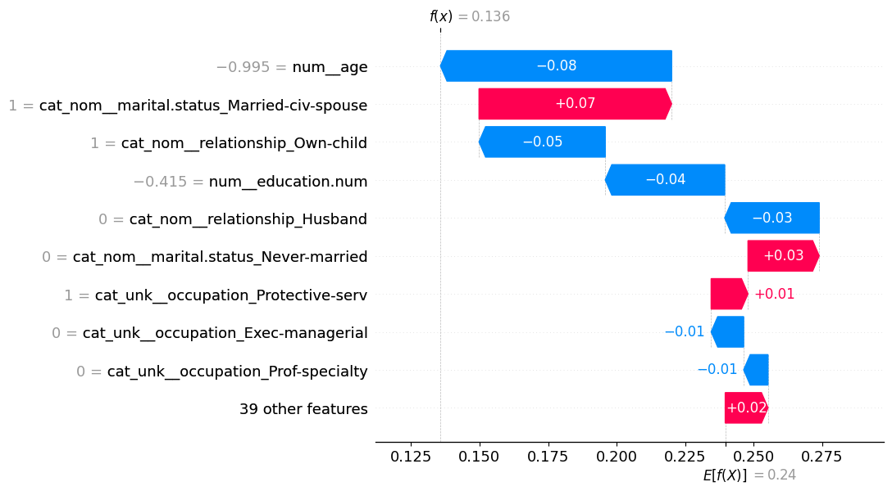
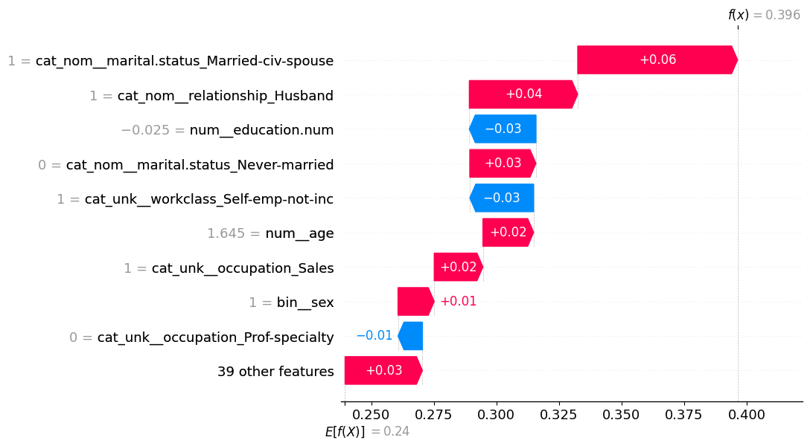

# Seção 3 — Interpretação e Explicabilidade dos Modelos

Nesta seção, abrimos a "caixa-preta" dos algoritmos através de técnicas avançadas de interpretabilidade e explicabilidade (**XAI — Explainable Artificial Intelligence**). Analisamos os coeficientes do modelo linear regularizado, a importância por impureza de Gini na Random Forest e aplicamos a teoria de valores de Shapley (**SHAP**) para diagnósticos globais e predições individuais.

---

## 1. Explicabilidade Global no Modelo Linear: Análise de Coeficientes

No modelo linear regularizado (**Regressão Logística L2**, $C=1,0$), a predição probabilística é dada pela função sigmoide aplicada à combinação linear dos atributos transformados:
$$P(Y=1|X) = \sigma(z) = \frac{1}{1 + e^{-z}}, \quad \text{onde } z = \beta_0 + \sum_{j=1}^{p} \beta_j X_j$$
O logaritmo da razão de chances (*log-odds*) varia linearmente com os regressores:
$$\ln\left(\frac{P(Y=1)}{1 - P(Y=1)}\right) = \beta_0 + \sum_{j=1}^{p} \beta_j X_j$$
Ao elevar a base de Euler à potência do coeficiente ($\text{OR}_j = e^{\beta_j}$), obtemos a **Razão de Chances (*Odds Ratio*)**, que indica quantas vezes a chance de pertencer à classe `>50K` é multiplicada para cada acréscimo unitário no atributo (ou presença da categoria One-Hot).

### Top 3 Coeficientes de Maior Magnitude Absoluta

Ordenando os coeficientes pela magnitude absoluta ($|\beta_j|$), destacam-se:

| Posição | Nome da Feature Transformada | Coeficiente ($\beta_j$) | Magnitude ($|\beta_j|$) | Razão de Chances ($\text{OR} = e^{\beta_j}$) | Efeito na Predição |
| :---: | :--- | :---: | :---: | :---: | :--- |
| **1º** | `cat_unk__workclass_Unknown` | **-1,6419** | **1,6419** | **0,1936** | Redutor Forte (-80,6%) |
| **2º** | `cat_nom__relationship_Own-child` | **-1,5292** | **1,5292** | **0,2167** | Redutor Forte (-78,3%) |
| **3º** | `cat_nom__marital.status_Married-AF-spouse` | **+1,5239** | **1,5239** | **4,5901** | Amplificador Forte (+359%) |

### Análise Sociodemográfica e Econômica

1. **`cat_unk__workclass_Unknown` ($\beta = -1,6419$ | $\text{OR} = 0,1936$):**
   - *Interpretação:* Indivíduos cuja classe de trabalho não foi informada (convertida para `"Unknown"`) possuem chances **80,6% menores** de pertencer à classe de alta renda quando comparados à referência.
   - *Fundamento:* A ausência de registro formal de classe trabalhista no Censo frequentemente correlaciona-se com desemprego de longa duração, economia informal precária ou indivíduos que abandonaram a força de trabalho ativa.
2. **`cat_nom__relationship_Own-child` ($\beta = -1,5292$ | $\text{OR} = 0,2167$):**
   - *Interpretação:* Morar com os pais sob a condição de "filho residente na família" reduz as chances de renda superior a US\$ 50K em **78,3%**.
   - *Fundamento:* Este grupo demográfico é majoritariamente composto por adolescentes, jovens universitários ou adultos em fase inicial de inserção profissional, que ainda não acumularam tempo de carreira suficiente para atingir o topo da pirâmide salarial.
3. **`cat_nom__marital.status_Married-AF-spouse` ($\beta = +1,5239$ | $\text{OR} = 4,5901$):**
   - *Interpretação:* Indivíduos casados com integrantes em serviço ativo nas Forças Armadas (*Armed Forces*) possuem chances **4,59 vezes maiores** de receber mais de US\$ 50K anuais.
   - *Fundamento:* O serviço militar federal norte-americano oferece remuneração institucional estável, planos de carreira estruturados e subsídios diretos para moradia e saúde familiar, elevando substancialmente o rendimento conjunto do núcleo conjugal.

---

## 2. Explicabilidade Global no Ensemble: Importância de Features (MDI)

Para o modelo campeão (**Random Forest Otimizada com Pipeline v2**), calculou-se a importância global das features via métrica **MDI (*Mean Decrease in Impurity*)**, também conhecida como *Gini Importance*. O MDI mensura a redução média ponderada da impureza de Gini provocada pelas divisões (*splits*) que utilizam cada atributo ao longo de todas as 300 árvores da floresta.

### Top 3 Features de Maior Importância

| Posição | Nome da Feature | Importância Relativa (MDI) | Percentual Acumulado |
| :---: | :--- | :---: | :---: |
| **1º** | **`num__education.num`** | **0,2094** | 20,94% |
| **2º** | **`cat_nom__marital.status_Married-civ-spouse`** | **0,1565** | 36,59% |
| **3º** | **`num__age`** | **0,1212** | 48,71% |

```
As 3 variáveis líderes sozinhas são responsáveis por quase 50% de todo o ganho
de pureza nas decisões tomadas pela floresta aleatória.
```

### Análise Sociodemográfica e Econômica

1. **`num__education.num` (Importância: 20,94%):**
   - *Fundamento Teórico:* O número de anos de estudo formal desponta como a feature mais influente da floresta. Esse resultado valida empiricamente a clássica **Teoria do Capital Humano de Jacob Mincer (1974)**: a escolaridade formal confere qualificações técnicas e de gestão que habilitam o trabalhador a ocupar posições de alta produtividade e remuneração no mercado.
2. **`cat_nom__marital.status_Married-civ-spouse` (Importância: 15,65%):**
   - *Fundamento Teórico:* O casamento civil formal com cônjuge presente atua como forte divisor sociodemográfico. Na economia laboral dos anos 1990, homens e chefes de família casados apresentavam os maiores rendimentos médios da base censitária, associados a estabilidade habitacional e maior divisão de encargos domésticos.
3. **`num__age` (Importância: 12,12%):**
   - *Fundamento Teórico:* A idade do trabalhador captura a evolução da experiência acumulada (*on-the-job training*), senioridade e progressão nas faixas corporativas, exibindo uma relação quadrática côncava com os rendimentos (ascensão até a maturidade e posterior estabilização pré-aposentadoria).

---

## 3. Interpretação Avançada com SHAP (SHapley Additive exPlanations)

Embora o MDI forneça uma visão rápida, ele sofre de limitações bem documentadas (superestima variáveis contínuas e não indica o sentido positivo ou negativo do impacto). Para superar isso e fornecer garantias teóricas formais, empregou-se o framework **SHAP (Lundberg & Lee, 2017)** com o algoritmo otimizado **`TreeExplainer` (Lundberg et al., 2020)**.

O SHAP fundamenta-se nos **Valores de Shapley da Teoria dos Jogos Cooperativos**, garantindo propriedades axiomáticas indispensáveis:
- **Eficiência:** A soma das contribuições de todas as features é exatamente igual à diferença entre a predição individual e o valor esperado base: $f(x) - E[f(X)] = \sum_{j} \phi_j$.
- **Simetria:** Atributos que contribuem identicamente em todas as coalizões recebem o mesmo valor Shapley.
- **Monotonicidade:** Se um modelo é alterado de modo que o impacto de uma feature aumente, seu valor SHAP jamais diminui.

```python
import shap

# 1. Transformação do teste com o preprocessor v2
x_test_transformed = preprocessor.transform(x_test)
X_test_df = pd.DataFrame(x_test_transformed, columns=preprocessor.get_feature_names_out())

# 2. TreeExplainer otimizado para Random Forest
explainer = shap.TreeExplainer(classifier)
shap_values = explainer(X_test_df)
```

---

### 3.1 Importância Global das Features via SHAP

O gráfico de barras a seguir apresenta a importância média absoluta dos valores SHAP ($E[|\phi_j|]$) calculada sobre todas as amostras do conjunto de teste para a classe positiva (`>50K`):


*Figura 15: Ranking de importância global das features via valores absolutos médios de SHAP ($E[|\phi|]$) para o classificador Random Forest.*

### Diagnóstico do Gráfico Global SHAP
- **Alinhamento e Robustez:** O gráfico corrobora plenamente as conclusões anteriores, posicionando `num__education.num` e `cat_nom__marital.status_Married-civ-spouse` no topo absoluto do poder explicativo médio do modelo.
- **Novas Descobertas:** Diferente do MDI simples, o SHAP revela o alto peso marginal de variáveis como `cat_nom__relationship_Husband`, `cat_nom__occupation_Exec-managerial` e `cat_nom__occupation_Prof-specialty`, que exercem empurrões decisivos na probabilidade positiva de renda superior a US\$ 50K.

---

### 3.2 Explicação Local de 3 Predições Individuais (Waterfall Plots)

Para ilustrar como o modelo sintetiza as informações para casos reais, foram extraídos os gráficos em cascata (*Waterfall Plots*) para 3 indivíduos específicos do conjunto de teste (Índices 0, 1 e 2).

O valor de referência global (*Expected Value*) do modelo é **$E[f(X)] = 0,240$**, que reflete exatamente a probabilidade basal a priori da classe positiva na base de treino.

---

#### Amostra 1 — Índice 0 ($f(x) = 0,256$)


*Figura 16: Decomposição SHAP Waterfall para a predição individual da Amostra do Índice 0.*

- **Ponto de Partida:** $E[f(X)] = 0,240$
- **Predição Final:** $f(x) = 0,256$ (Ligeiramente acima do limiar basal)
- **Fatores Impulsionadores (Positivos):**
  - `num__age` ($+0,05$): A idade madura do indivíduo aumentou sua probabilidade em 5 pontos percentuais.
  - `cat_nom__relationship_Husband` ($+0,03$): O papel familiar de chefe de domicílio adicionou outros 3 pontos percentuais.
- **Fatores Retratores (Negativos):**
  - Ajustes marginais negativos em ocupação e horas de trabalho reduziram o impacto, resultando em uma probabilidade intermediária ($25,6\%$).

---

#### Amostra 2 — Índice 1 ($f(x) = 0,136$)


*Figura 17: Decomposição SHAP Waterfall para a predição individual da Amostra do Índice 1.*

- **Ponto de Partida:** $E[f(X)] = 0,240$
- **Predição Final:** $f(x) = 0,136$ (Queda acentuada, classificado com segurança como `<=50K`)
- **Fatores Determinantes da Redução:**
  - `num__age` ($-0,08$): A pouca idade do indivíduo foi o principal redutor (-8 pontos percentuais), evidenciando alguém no início da juventude profissional.
  - `num__education.num` ($-0,04$): Nível de escolaridade abaixo da média geral rebaixou a probabilidade em outros 4 pontos percentuais.
  - O modelo conclui com alta convicção que o perfil não preenche os requisitos para auferir mais de US\$ 50.000 anuais.

---

#### Amostra 3 — Índice 2 ($f(x) = 0,396$)


*Figura 18: Decomposição SHAP Waterfall para a predição individual da Amostra do Índice 2.*

- **Ponto de Partida:** $E[f(X)] = 0,240$
- **Predição Final:** $f(x) = 0,396$ (A predição mais elevada entre as três amostras analisadas)
- **Fatores Determinantes da Ascensão:**
  - `cat_nom__marital.status_Married-civ-spouse` ($+0,06$): O casamento civil gerou o maior impulso positivo (+6 pontos percentuais).
  - `cat_nom__relationship_Husband` ($+0,04$): A categoria de relacionamento conjugal agregou mais 4 pontos percentuais.
  - Escolaridade superior atuou de forma cumulativa, aproximando a probabilidade individual de quase 40%.
