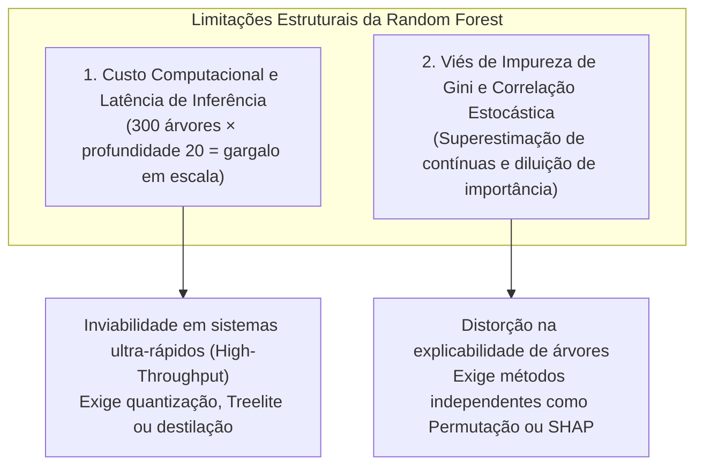
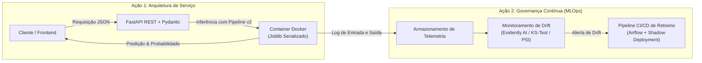

# Seção 4 — Discussão Crítica, Limitações e MLOps

Uma análise técnica de excelência acadêmica requer não apenas a celebração de métricas elevadas, mas um diagnóstico maduro sobre as vulnerabilidades estruturais do modelo, os limites epistemológicos dos dados e as soluções práticas de engenharia de software para viabilizar sua operação sustentável no mundo real (**MLOps**).

---

## 1. Duas Limitações do Melhor Modelo Obtido (Não Apresentadas Anteriormente)

Embora a **Random Forest Otimizada com Pipeline v2** tenha alcançado excelente capacidade de ordenação probabilística (ROC-AUC de **0,8910** no teste), ela apresenta fragilidades intrínsecas que devem ser consideradas:

### Limitação 1: Latência de Inferência e Pegada Computacional em Produção (*High-Throughput Latency*)
* **Diagnóstico Técnico:** O modelo final é constituído por um comitê de **300 árvores de decisão**, cada uma treinada com profundidade de até **20 níveis**. Durante a inferência, para cada registro individual submetido, o algoritmo precisa percorrer centenas de nós de decisão ramificados em dezenas de árvores na memória RAM para computar a média das probabilidades:
$$\text{Complexidade de Inferência} = O(T \cdot D)$$
onde $T = 300$ (número de árvores) e $D = 20$ (profundidade máxima).
* **Impacto Operacional:** Em cenários de produção com alta concorrência (*high-throughput*), como portais de e-commerce, sistemas de detecção de fraude em tempo real ou plataformas de aprovação de crédito com dezenas de milhares de requisições por segundo, o custo de CPU e a latência de milissegundos tornam-se um gargalo custoso. Em contrapartida, modelos lineares exigem apenas um produto escalar direto de vetores ($O(P)$), executado em microssegundos (HASTIE; TIBSHIRANI; FRIEDMAN, 2009).
* **Mitigação:** Para viabilizar a inferência sem perda de acurácia, seria recomendável compilar a floresta via **Treelite** (compilação para código C puro sem overhead de ponteiros Python) ou realizar a **Destilação de Modelo (*Knowledge Distillation*)**, treinando uma rede neural compacta para reproduzir as saídas da Random Forest.

### Limitação 2: Viés de Impureza de Gini e Diluição por Multicolinearidade
* **Diagnóstico Técnico:** O algoritmo de partição recursiva das árvores de decisão exibe uma tendência sistemática a favorecer variáveis numéricas contínuas (como `age`) ou variáveis categóricas com muitas categorias em detrimento de variáveis binárias simples (como `sex`). Como atributos com múltiplos valores oferecem muito mais opções aleatórias de pontos de corte, a probabilidade de um split reduzir a impureza de Gini puramente por acaso é substancialmente mais alta (STROBL et al., 2007).
* **Impacto Operacional:** Além disso, a presença de variáveis altamente correlacionadas no dataset (como `marital.status` e `relationship`) gera um fenômeno de "canibalização" da importância: as árvores dividem as amostras ora por uma, ora por outra de forma estocástica, diluindo artificialmente o escore MDI de ambas e mascarando a real relevância causal de cada atributo.

---

## 2. Duas Limitações Intrínsecas dos Dados Utilizados

A qualidade de qualquer solução de Machine Learning está irrevogavelmente subordinada à integridade e representatividade da base de treinamento (*Garbage In, Garbage Out*).

### Limitação 1: Defasagem Temporal de 30 Anos e Desvio de Conceito (*Concept Drift* / Inflação)
* **Diagnóstico Técnico:** A base *Adult Census Income* é um recorte estático do ano de **1994**. Ao longo das últimas três décadas, a economia global passou por transformações tectônicas:
  1. **Inflação Cumulativa:** US\$ 50.000 em 1994 equivalem a mais de **US\$ 105.000 em valores presentes**, devido à inflação acumulada do dólar. O limiar de US\$ 50.000 hodierno representa uma faixa salarial consideravelmente mais baixa do que o estrato de classe média-alta/alta que representava em 1994.
  2. **Reconfiguração do Mercado de Trabalho:** O surgimento do setor de tecnologia da informação em massa, a expansão do trabalho remoto e da *gig economy*, e mudanças profundas na participação feminina e na legislação trabalhista tornam a estrutura salarial de 1994 anacrônica.
* **Consequência:** Na literatura de ciência de dados, este fenômeno é formalmente classificado como **Concept Drift** (GAMA et al., 2014): a distribuição estatística conjunta $P(X, Y)$ e a fronteira condicional $P(Y|X)$ mudaram com o tempo. Um modelo treinado nessa base falharia drasticamente se aplicado à população americana contemporânea.

### Limitação 2: Perda Drástica de Granularidade por Binarização Arbitrária da Renda
* **Diagnóstico Técnico:** O problema foi originalmente formulado pelo Census Bureau convertendo uma variável de renda salarial real contínua ($Y \in \mathbb{R}^+$) em um target booleano artificial ($Y \in \{\le 50\text{K}, >50\text{K}\}$).
* **Consequência Analítica:** Essa binarização elimina brutalmente a variabilidade e a assimetria da distribuição de renda:
  - Trata um trabalhador que ganha **US\$ 50.001** como exatamente igual a um executivo com salário anual de **US\$ 2.000.000**.
  - Da mesma forma, coloca no mesmo grupo um indivíduo desempregado com renda zero e outro que aufere **US\$ 49.999**.
  - Ao descartar toda a riqueza econométrica contínua, o modelo é forçado a classificar em torno de uma fronteira de corte rígida e arbitrária, impedindo o cálculo de métricas de valor esperado financeiro ou elasticidade salarial.

---

## 3. Duas Ações Concretas para Operacionalização e Manutenção

Para transpor o projeto da bancada experimental para um ambiente produtivo corporativo de alta confiabilidade, propõem-se duas iniciativas de Engenharia de MLOps:

### Ação 1: Microsserviço de Inferência em Tempo Real Conteinerizado (FastAPI + Docker)
* **Estrutura Técnica:**
  1. **Serialização Completa:** Exportar o pipeline campeão (`preprocessor_v2` acoplado ao `RandomForestClassifier`) como um artefato único serializado via `joblib` (`model_pipeline_v2.joblib`). Isso garante que nenhuma lógica de pré-processamento (imputação, escalonamento, OHE) seja replicada manualmente na aplicação de consumo, eliminando o clássico risco de *training-serving skew*.
  2. **API REST com Validação Estrita:** Encapsular a inferência em uma API assíncrona leve utilizando o framework **FastAPI**. Definir contratos de esquema rigorosos com **Pydantic** para validar tipagens, faixas etárias válidas e categorias antes de despachar para o modelo, retornando mensagens de erro informativas para dados corrompidos.
  3. **Conteinerização Docker:** Empacotar a aplicação em uma imagem Docker minimalista (`python:3.11-slim`), fixando versões exatas de bibliotecas no `requirements.txt`. A imagem pode ser implantada em clusters Kubernetes com dimensionamento horizontal automático (*Horizontal Pod Autoscaling*) com base no tráfego de requisições.

### Ação 2: Monitoramento Contínuo de Data Drift e Pipeline de Retreino Automatizado
* **Estrutura Técnica:**
  1. **Mitigação da Dívida Técnica:** Sistemas de Machine Learning acumulam "dívida técnica oculta" quando operam em produção sem vigilância contínua sobre a evolução dos dados (SCULLEY et al., 2015).
  2. **Monitoramento Estatístico em Tempo Real:** Implementar uma rotina de observabilidade (utilizando ferramentas como **Evidently AI** ou **Prometheus + Grafana**) para calcular periodicamente métricas de desvio entre os dados recebidos em produção e os dados da base de treino:
     - **Teste Kolmogorov-Smirnov (KS-Test):** Para variáveis numéricas (`age`, `education.num`).
     - **Índice de Estabilidade Populacional (*Population Stability Index* — PSI):** Para variáveis categóricas (`workclass`, `marital.status`). Um $PSI > 0,2$ dispara alertas críticos de *Data Drift*.
  3. **Pipeline de Retreino Automatizado:** Ao detectar desvios estatísticos significativos ou a cada novo lote de dados censitários auditados, um orquestrador (como Apache Airflow ou GitHub Actions) dispara o pipeline de retreino. O novo modelo candidato é avaliado automaticamente contra o modelo atual (*Champion vs. Challenger*). Se o novo modelo demonstrar superioridade estatística no ROC-AUC em ambiente *Shadow* (recebendo tráfego espelhado sem impactar o usuário final), ele é promovido automaticamente para produção sem indisponibilidade de serviço.
